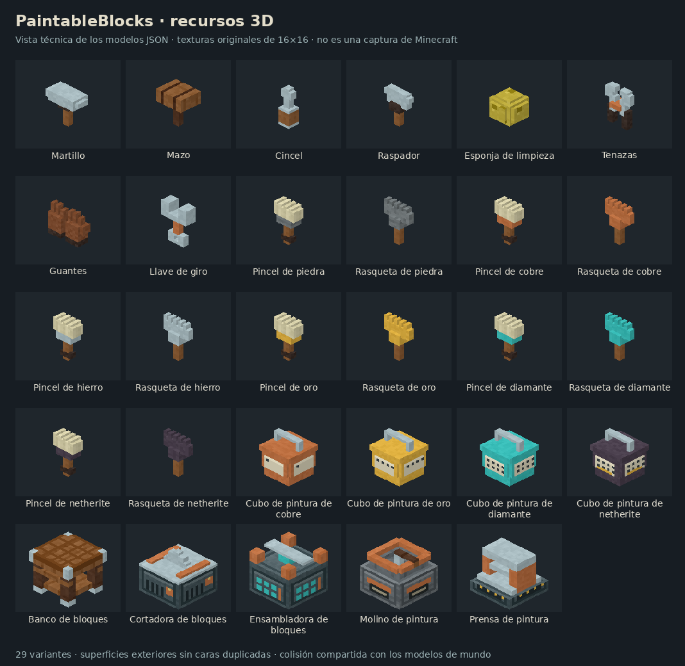

# Recursos visuales: bloques y herramientas

Se completan **29 variantes registradas**: ocho herramientas de edición/conservación, seis pinceles, seis rasquetas, cuatro cubos de pintura y cinco bloques de producción. Las funciones estaban implementadas en los grupos anteriores; la petición actual autoriza sus recursos definitivos y sustituye la prohibición temporal de crearlos.

La imagen es una representación ortográfica por software de los JSON y PNG entregados, no una captura de Minecraft. Permite revisar siluetas y materiales; no acredita iluminación, animación o funcionamiento en juego.

## Recursos creados

- **20 herramientas 3D:** martillo de acero, mazo de madera, cincel, raspador, esponja porosa, tenazas, par de guantes y llave de giro. Pinceles con cerdas claras y abrazadera del material; rasquetas con hoja dentada del material. Las seis variantes usan cobblestone, cobre, hierro, oro, diamante y netherite.
- **Cuatro recipientes 3D:** latas de pintura con tapa cerrada y asa. El material identifica el nivel; las marcas de la etiqueta indican 1, 4, 8 y 8 identidades. Netherite añade una marca dorada para distinguir su capacidad superior. Las cantidades/pinturas reales siguen consultándose en interfaz y tooltip; no se representa un nivel de líquido ficticio.
- **Cinco modelos de producción:** banco con patas, estante y tablero; cortadora con guías y hoja; ensambladora con pórtico; molino con tolva y manivela; prensa con columnas y plato. Mantienen sus IDs y orientación de colocación existentes.
- **28 texturas originales de 16×16:** materiales compartidos, etiquetas y paneles de máquinas, con píxeles opacos y paleta coherente de madera, acero y cobre. No se usa extrusión automática de un icono plano como sustituto del modelo 3D.
- **Bote de pintura existente:** tapa/asa remalladas y material de acero propio; el cuerpo conserva la representación dinámica del catálogo. Las cinco variantes pintables mantienen su representación de diseño y el original `unpainted.png`, sin modificarlo ni convertirlo en pintura.

Los recursos están en `assets/paintableblocks/models`, `items`, `blockstates` y `textures`. Los padres de pincel/rasqueta/recipiente comparten geometría; cada variante resuelve sus propios materiales. Los archivos PNG de juego son todos de 16×16. La lámina de documentación tiene mayor tamaño y no se carga como textura del juego.

## Prevención del parpadeo

Los modelos se generan como el límite exterior de una unión de vóxeles etiquetados. Cambiar de material sustituye la etiqueta del sólido: no añade una segunda superficie encima. Se eliminan las caras entre piezas en contacto y después se fusionan los rectángulos contiguos del mismo material/plano. Cada elemento dibuja únicamente su cara exterior.

Las coordenadas son enteras en la cuadrícula 0–16 y los elementos tienen volumen positivo. No se utilizan planos de grosor cero, transparencias para recortar siluetas, escalados negativos ni capas de adorno coplanares. Los UV explícitos conservan el tamaño de píxel y no salen de la textura. `cullface` se asigna solo a caras en el borde real del bloque, no a asas o caras interiores de huecos.

También se corrigen dos contactos del render existente: el cuerpo del bote no dibuja la cara superior tapada, y la tapa omite su contacto inferior sobre ese cuerpo. Al proyectar pinturas vanilla se filtra la normal real del quad antes de aplanarlo: una dirección de culling puede contener caras de vuelta, como en la nieve en polvo. Se conservan las capas decorativas vanilla intencionadas, incluida la hierba.

La validación geométrica no detecta ni garantiza eliminar cualquier artefacto de controladores, shaders o paquetes de recursos externos. No se ha realizado una prueba de cámara/animación en Minecraft.

## Colisión y selección coherentes

`design/VisualShapes.java` se genera desde los mismos sólidos: **91 cajas disjuntas para los nueve bloques de mundo**. Colisión, selección y apoyo siguen la forma real de patas, cuerpos, asas y piezas de máquinas. No se conserva el cubo invisible de los modelos provisionales. Los bloques dejan de ocultar por completo las caras de sus vecinos a través de los huecos.

Las formas son comunes al cliente y servidor; hay que actualizar ambos lados para que coincidan. No cambia el protocolo 4, las recetas, capacidades ni los componentes de los diseños conservados.

## Decisiones tomadas durante esta entrega

1. Estética de taller compatible con Minecraft: madera y metal, pinceles de cerda clara y niveles diferenciados por material/color.
2. Recipientes cerrados con indicadores de número de identidades; sin inventar pintura o nivel de líquido según una imagen estática.
3. Geometría exterior única en lugar de cajas completas superpuestas o láminas decorativas; familias por material comparten padres.
4. Formas físicas generadas junto a los recursos para no introducir colisión invisible alrededor de los nuevos huecos.
5. Mantener intactos el PNG original y las texturas/identidades del catálogo; limpiar únicamente los contactos y caras de vuelta que podían superponerse al representarlos.

## Herramientas y evidencia

- `python tools/generate_visual_assets.py`: genera los recursos y las formas físicas; no ejecuta Java, Gradle ni Minecraft. Requiere Pillow y no lee/reinterpreta el PNG original para generarlo otra vez.
- `python tools/preview_visual_assets.py`: genera esta lámina técnica a partir de las caras de los recursos.
- `python tools/validate_visual_assets.py`: comprueba tamaños/opacidad, enlaces, UV, volúmenes positivos, solapes coplanares en ambos sentidos y equivalencia entre superficie visual, cajas de colisión y código Java generado. También verifica el SHA-256 del original.
- Los validadores de grupos 1–3 se actualizan para el estado actual: ya no exigen ausencia de recursos ni cubos sin texturas.

Resultado estático: 33 archivos de modelo con superficies —incluidos padres/variantes—, 20 654 parches unitarios revisados, **cero solapes coplanares** en los recursos revisados y nueve modelos de colisión coincidentes. Sintaxis Java e importaciones de la integración revisadas con la referencia 26.2.

No se compilaron ni ejecutaron Java, Gradle, CI o Minecraft. Siguen pendientes las comprobaciones en juego de iluminación, oclusión, manos, animaciones, recursos recargados y cámara desde distintas distancias. Publicación directa online en la rama `26.2`, sin commits locales.

## Corrección posterior: atlas de texturas

La revisión posterior detectó un fallo de carga que la comprobación anterior de PNG existentes no cubría. Los 14 materiales compartidos estaban bajo `textures/material/`; 13 de ellos estaban referenciados por los modelos. El atlas de bloques de Minecraft 26.2 carga por defecto el directorio `block/` y el de ítems carga `item/`: no descubren automáticamente `material/`.

Se trasladan los 14 PNG a `textures/block/material/` y se actualizan los identificadores a `paintableblocks:block/material/...`, incluidos modelos padre, variantes, partículas y generador. Sus bytes, píxeles, tamaño y opacidad permanecen idénticos. No se añaden atlas globales ni copias duplicadas de las imágenes. El original `unpainted.png` permanece intacto.

`validate_visual_assets.py --minecraft-jar /ruta/minecraft-26.2-client.jar` lee los JSON de atlas del cliente oficial cuyo SHA-1 se verifica; ahora exige que cada sprite del modelo sea descubierto por una fuente del atlas, además de existir en disco. La nueva comprobación falló con las rutas anteriores y pasa con las corregidas: 28 sprites referenciados disponibles en el atlas de bloques. Sin el argumento se utilizan las reglas de directorio de referencia de 26.2. El helper también reconoce fuentes locales explícitas de directorio y de sprite individual; no simula paquetes de recursos externos arbitrarios.

`python -m unittest discover -s tools/tests -p 'test_texture_atlas.py'` ejecuta seis regresiones Python: archivo existente fuera del atlas, subdirectorios, namespace, alias sin registrar, separación de atlas de ítems/bloques y fuentes explícitas. Pasan las seis.

Se volvió a revisar la geometría: los 33 modelos conservan exactamente sus elementos y transformaciones; siguen sin detectarse solapes en 20 654 parches y coinciden las nueve colisiones. La lámina técnica es idéntica en bytes al regenerarla: abrir un PNG directamente en una herramienta de inspección no demostraba que Minecraft lo incluyera en el atlas. Por eso ahora se comprueba también esa frontera de carga.

No se modifican mecánicas, código Java, protocolo ni dibujos. Decisión adoptada: utilizar la estructura estándar `block/material/` para compartir sprites de modelos de bloques e ítems 3D, en vez de alterar el atlas global. Sin compilación ni ejecución de Minecraft; la comprobación de carga/recarga dentro del juego continúa pendiente.
